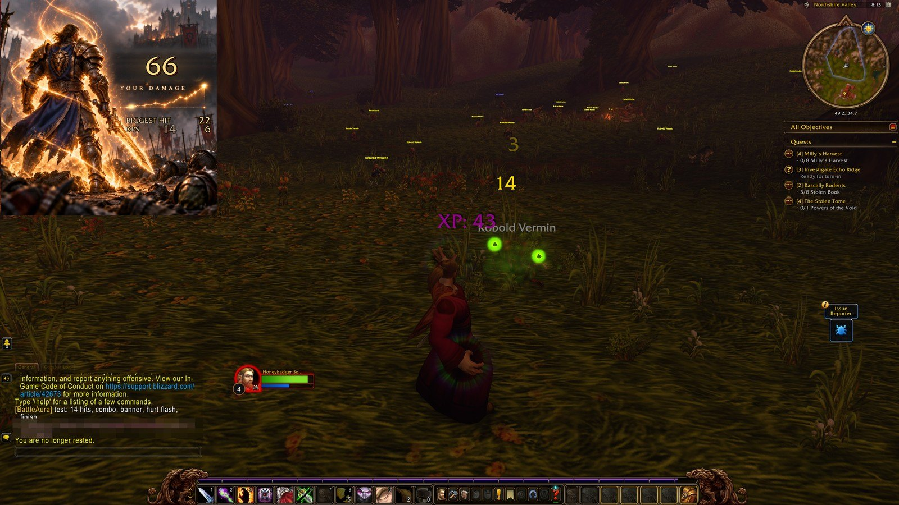
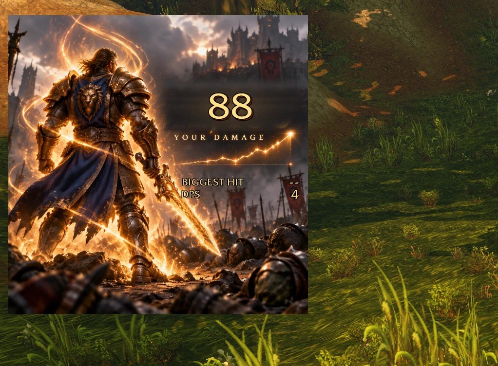
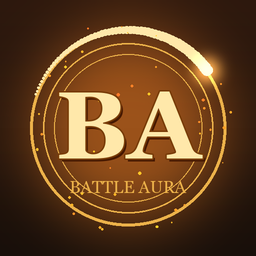

# Battle Aura

An immersive personal damage meter for **World of Warcraft: Forever** (Interface 16001). Free. Your own damage, shown on a battle scene instead of a bar chart.

**Get it:** [CurseForge](https://www.curseforge.com/wow/addons/battle-aura) · [WoWInterface](https://www.wowinterface.com/downloads/info27234-BattleAura.html) · [Releases](https://github.com/honeybadger-software/battle-aura/releases/latest) · [honeybadger.software/downloads](https://honeybadger.software/downloads)

## What you see

- **YOUR DAMAGE**, the big gold number: total damage this fight
- **BIGGEST HIT** and **DPS**
- Every hit floats up as a number (crits bigger and hotter), shakes the frame and rings out
- A comet runs your spark-line; embers and the aura build as the fight heats up
- A combo counter from your casts, and a red flash when you are hit
- **NEW BEST HIT / DPS / DAMAGE!** banners against your own records

It is built on Blizzard's own damage meter (`C_DamageMeter`), so it works with Forever's restricted combat data.

## Install

1. Close the game.
2. Unzip so the folder is `...\World of Warcraft\<your Forever folder>\Interface\AddOns\BattleAura` (inside it you should see `BattleAura.toc` and an `Art` folder).
3. Start the game.

If the picture ever shows as a blank or green square, fully restart the game once (new texture files load at startup).

## Commands

| Command | What it does |
|---|---|
| drag the picture | move it |
| `/ba` | show the options |
| `/ba scale 0.3-1.2` | size of the frame |
| `/ba font 60-200` | size of the big number |
| `/ba aura` | aura glow on/off |
| `/ba hits` | floating hit numbers on/off |
| `/ba grouphits` | hit numbers while grouped (also shows other players' hits on your target) |
| `/ba best` | your records |
| `/ba test` | preview every effect, no fight needed |
| `/ba reset` | back to defaults |

## Notes

- Floating hit numbers are off by default while you are in a group, because the game reports every player's hits on a target.
- Records and the fight log are stored only on your computer (SavedVariables). Nothing is sent anywhere.
- Free for everyone. Please do not redistribute modified copies or sell it. See [LICENSE.txt](LICENSE.txt).
- Changes are in [CHANGELOG.txt](CHANGELOG.txt). The plain-text readme that ships in the zip is [README.txt](README.txt).

## Questions, bugs, ideas

Whisper **Honeybadger Software** in game (WoW Forever), or open an issue here. All whispers welcome.

---

Made by **Honey Badger Software** · [honeybadger.software](https://honeybadger.software) · [@HoneyBadgerMods](https://x.com/HoneyBadgerMods) 
World of Warcraft is a trademark of Blizzard Entertainment. Battle Aura is a fan-made addon, not affiliated with or endorsed by Blizzard.
